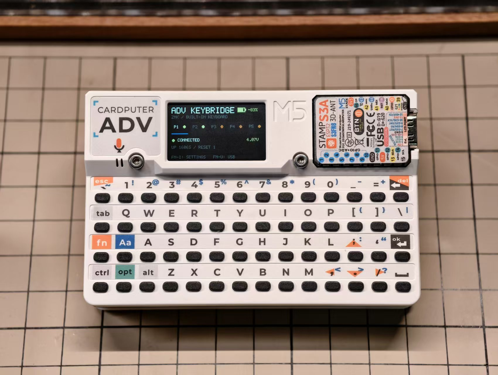
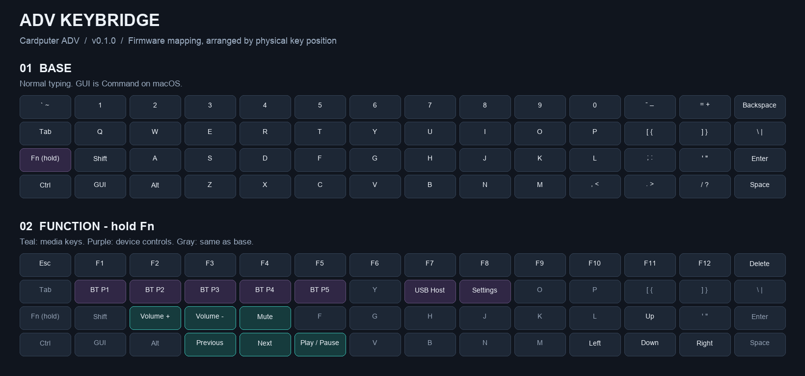

# ADV KeyBridge

For Cardputer ADV.

[下载固件](https://github.com/nenipresotReta/adv-keybridge/releases)

基于 ZMK 的蓝牙键盘桥接固件，将 ADV 内置键盘或 USB 外接键盘的输入通过蓝牙发送到其他设备，支持媒体键。

## 操作

- **Fn+U**：开启 / 关闭 USB Host。
- **Fn+I**：打开设置页，可开关蓝牙槽、调整亮度和自动熄屏时间。W/S 滚动，A/D 调整，Enter 确认。
- **Fn+Q/W/E/R/T**：按主页显示顺序选择已启用的槽位；关闭槽位不会删除配对。
- **G0**：主界面短按切换到下一个蓝牙槽；设置页短按返回；熄屏时短按唤醒，不切换蓝牙槽。
- **清除配对**：主界面长按 G0 约 1.5 秒，松开后再短按确认，清除当前槽配对。重新配对时，也在电脑端忽略旧设备。

## 键位

## License

[MIT](LICENSE). Third-party components retain their [original licenses](LICENSES/README.md).
